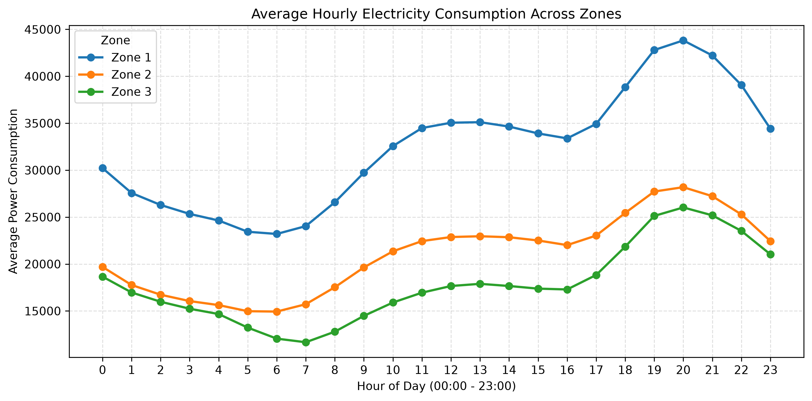
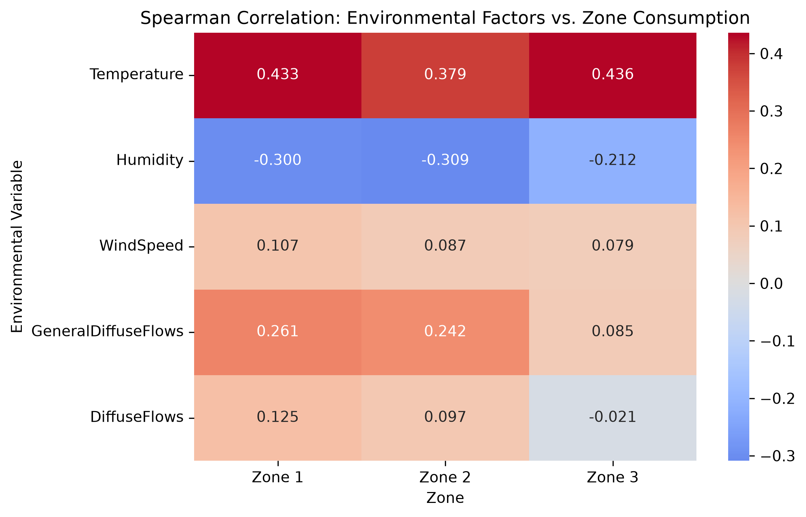

# Electricity Consumption & Environmental Analysis Across Three Zones (Morocco)

## Project Overview
This project analyzes 10-minute electricity consumption records (`52,416` rows, `9` features) across three geographical zones in Morocco alongside meteorological variables (`Temperature`, `Humidity`, `WindSpeed`, `GeneralDiffuseFlows`, and `DiffuseFlows`). The goal is to uncover temporal demand patterns, evaluate weather associations, compare zone profiles, and provide actionable recommendations for grid management.

## Key Findings
* **Zone Demand Hierarchy:** **Zone 1** records the highest average consumption (`Mean = 32,344.97`, `Median = 32,265.92`) and widest absolute variability (`Std Dev = 7,130.56`, `IQR = 10,998.35`), followed by **Zone 2** (`Mean = 21,042.51`) and **Zone 3** (`Mean = 17,835.41`). Kruskal-Wallis and Levene tests confirm statistically significant differences across zones.
* **Temporal Cycles:** Across all three zones, electricity demand drops to a low trough around **05:00–06:00** and surges to an evening peak around **19:00–20:00**. Time-series decomposition (`statsmodels`) separates recurring seasonal cycles and long-term trends from irregular residuals.
* **Environmental Associations:** Spearman rank correlations (`SciPy` and `Plotly`) evaluate monotonic relationships between meteorological factors and consumption while accounting for temporal autocorrelation and confounding variables.

## Visual Highlights

*All three zones share a clear daily rhythm with an early-morning trough around 05:00–06:00 and an evening peak around 19:00–20:00, with Zone 1 consistently at the highest load level.*


*Spearman rank correlations summarize how weather variables relate to consumption across the three zones.*

## Libraries & Tools
* **Python 3.10+** & **Jupyter Notebook**
* **pandas & numpy** (data auditing, resampling/aggregation, descriptive statistics)
* **scipy** (Spearman and Pearson correlations, Kruskal-Wallis and Levene tests)
* **statsmodels** (time-series `seasonal_decompose`)
* **matplotlib, seaborn & plotly** (static and interactive visualizations)

## Installation Requirements
1. Clone this repository and navigate to the project folder:
   ```bash
   git clone <your-repository-url>
   cd <your-repository-folder>
